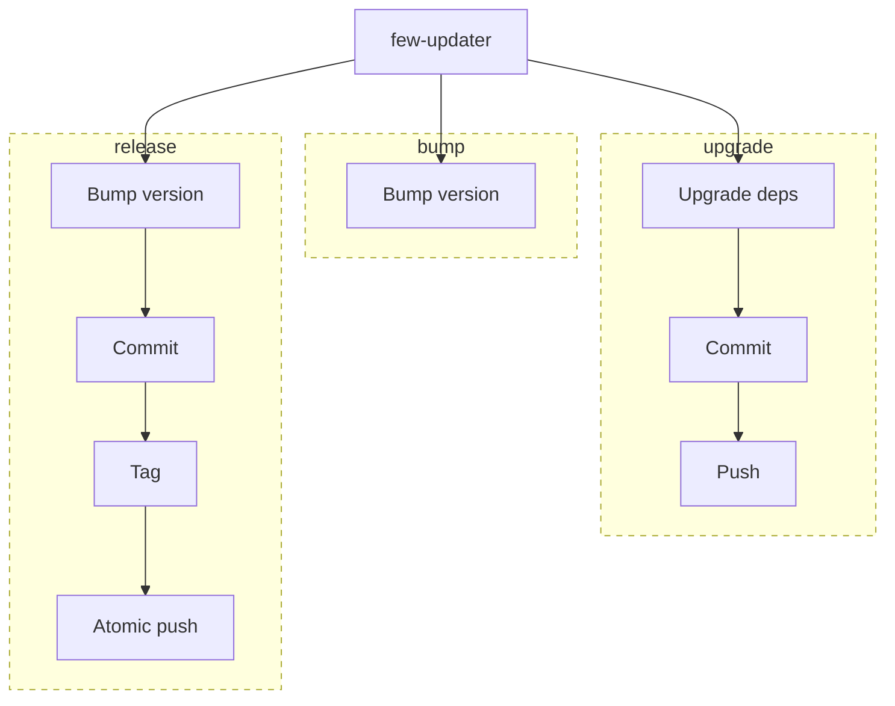

# few-updater

A lightweight CLI to manage common maintenance and release operations consistently
across projects using different package managers, such as **uv** and **npm**.



## Installation

Requires Git and the selected package manager (uv or npm).

```bash
uv tool install .
```

## Usage

Run in a terminal at the Git repository root, on `main`.

```bash
few-updater upgrade
few-updater bump major|minor|patch
few-updater release
few-updater release --bump minor
few-updater release --no-bump
```

- `upgrade`: updates dependencies within existing constraints, then automatically
  commits and pushes changed dependency files without confirmation.
- `bump`: confirms once (default no) and leaves the native version bump local.
- `release`: confirms once (default no), bumps patch by default, commits changed
  version files, and atomically pushes `main` with an annotated version tag.
  `--bump` selects the increment; `--no-bump` publishes the declared version.
  An already released HEAD exits successfully without confirmation, even with
  local version changes.

Versioning is delegated to uv/npm. Releases publish Git refs, not packages.

For detailed behavior and constraints, see the [specifications](specs/).
